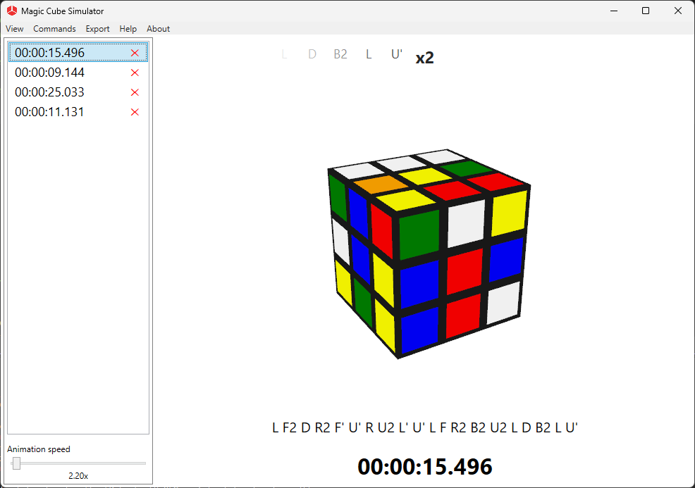
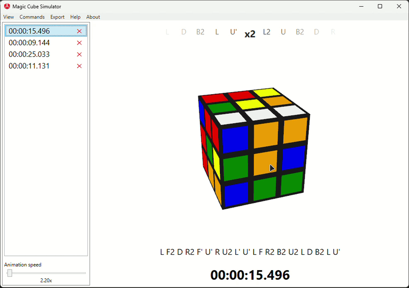

# Magic Cube Simulator


**Magic Cube Simulator** is a native 3D Rubik's Cube application built with C# and WPF. It features smooth animations, a built-in timer, and support for multiple solving algorithms including CFOP and Kociemba.


[](https://github.com/BananaOvf/magic-cube-project/actions/workflows/dotnet.yml)

[](https://www.gnu.org/licenses/gpl-3.0)

[](https://dotnet.microsoft.com/)





## Features


* **Interactive 3D Cube:** Full 3D rotation and zooming using WPF's native `Viewport3D`.
* **Multiple Solvers:** Includes both the classic CFOP method and Kociemba's Two-Phase Algorithm.
* **Smooth Animations:** Every move is animated with configurable speed.
* **Timer \& Statistics:** Built-in timer with hold-to-start and auto-save functionality.
* **Localization:** Full support for both English and Russian languages.
* **Excel Export:** Export your solve history to an `.xlsx` file.





## Getting Started


### Prerequisites


* **Operating System:** Windows 10 or later.
* **SDK:** [.NET 8.0 SDK](https://dotnet.microsoft.com/download/dotnet/8.0) (or later).
* **IDE:** Visual Studio 2022 (recommended) or JetBrains Rider.


### 

### Build & Run


1. **Clone the repository:**

```bash
git clone https://github.com/BananaOvf/magic-cube-project.git
cd magic-cube-project
```


2. **Restore and build:**

```bash
dotnet build
```


3. **Run the application:**

```bash
dotnet run --project src/MagicCube.UI
```

Alternatively, open `MagicCube.slnx` in Visual Studio and press `F5`.


## Architecture


The solution is split into several projects:


* `MagicCube.Core`: The core logic of the Rubik's Cube (state, moves, history).
* `MagicCube.Services`: Interfaces for services.
* `MagicCube.Infrastructure`: Implementations for services (solvers, repositories, settings).
* `MagicCube.UI`: The WPF application (views, viewmodels, renderers).
* `tests/`: Unit tests for the core logic.


## Roadmap

We are actively developing this project. Here is what we have planned for future releases:

- [x] Core 3D simulator with CFOP and Kociemba solvers.
- [x] Localization (English / Russian).
- [ ] **Computer Vision Module:** Automatically recognize and track the cube state from a webcam.
- [ ] **Realistic 3D Models:** Replace primitive shapes with high-quality 3D meshes, rounded corners, and realistic materials.
- [ ] **Interactive Mouse Controls:** Click and drag directly on the cube's faces to perform turns (utilizing 3D hit testing).
- [ ] **UI/UX Improvements:** Dark theme and customizable color schemes.
- [ ] **Performance:** Further optimization of the 3D rendering for low-end PCs.

*If you want to help with any of these features, feel free to open a Pull Request!*

*If you want to help with any of these features, feel free to open a Pull Request!*


## Contributing


Contributions are welcome! Please open an issue or submit a pull request. For major changes, please open an issue first to discuss what you would like to change.


## License


This project is licensed under the **GNU General Public License v3.0 (GPLv3)**. See the [LICENSE](LICENSE) file for the full text.


This project also includes third-party code. See [THIRD\_PARTY\_LICENSES.md](THIRD_PARTY_LICENSES.md) for details.


## Acknowledgments


* **Kociemba Two-Phase Algorithm:** Herbert Kociemba (http://kociemba.org/)
* **C# Port of Kociemba:** Megalomatt (https://github.com/Megalomatt/Kociemba)
* **CFOP Solver (CubeXdotNET):** Divin Mathew (divinsmathew)

